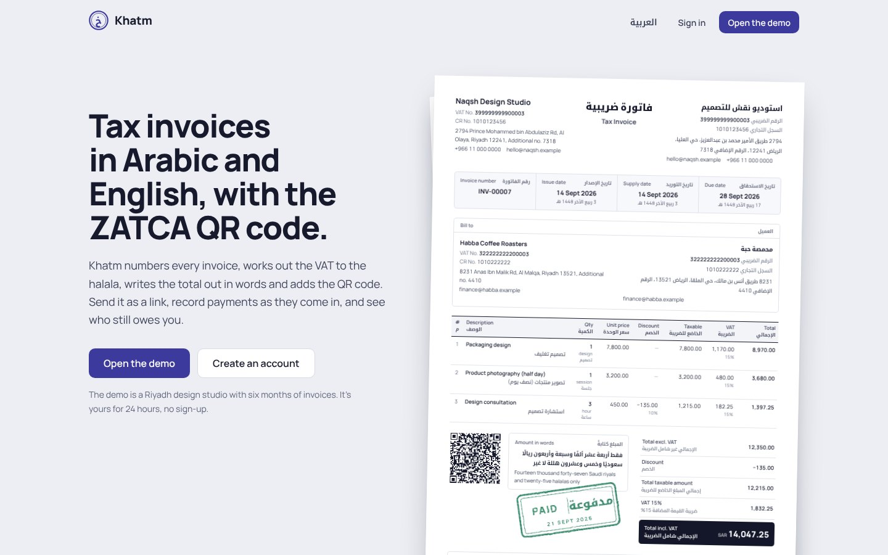
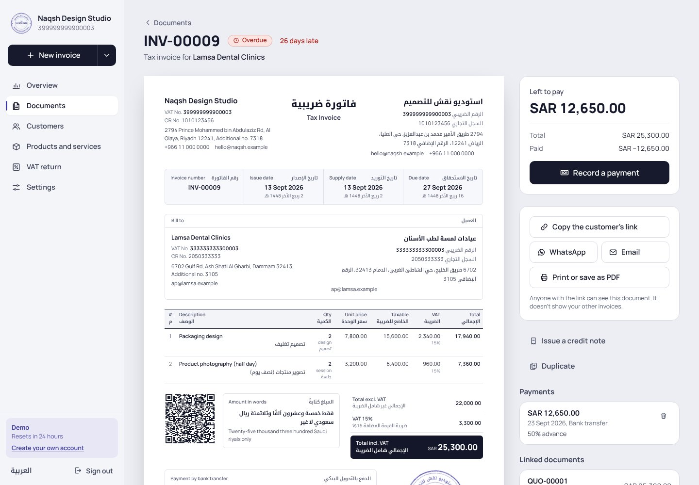
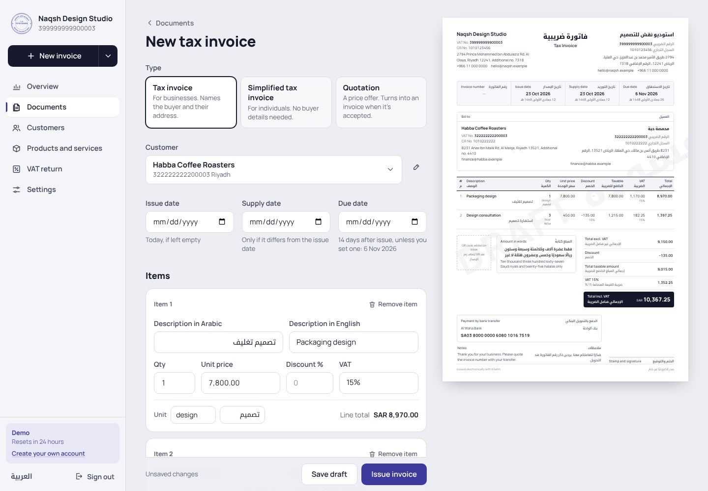
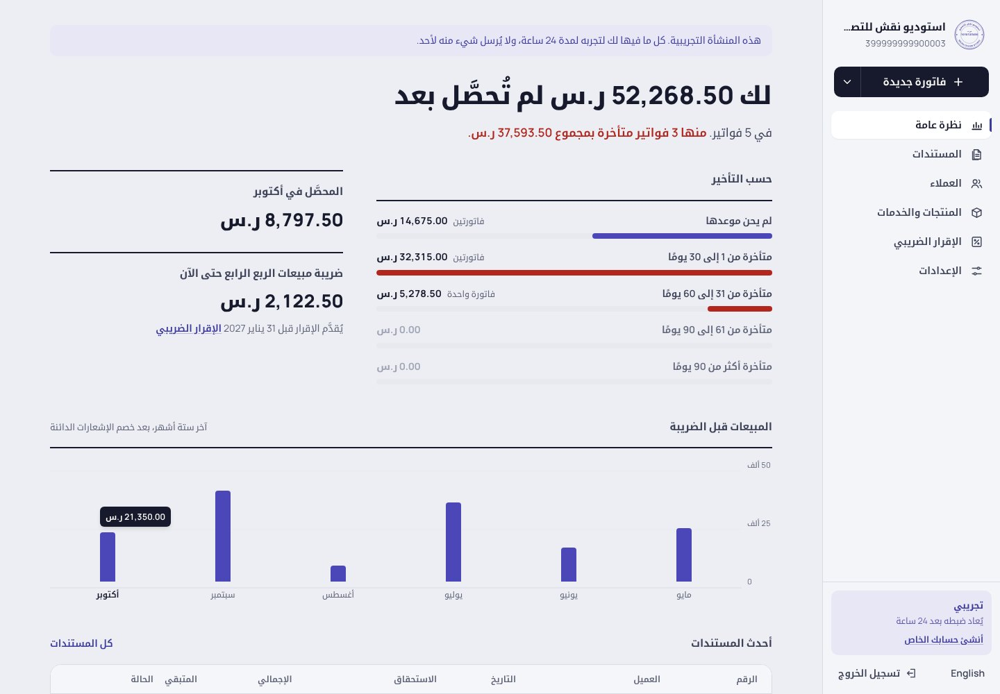
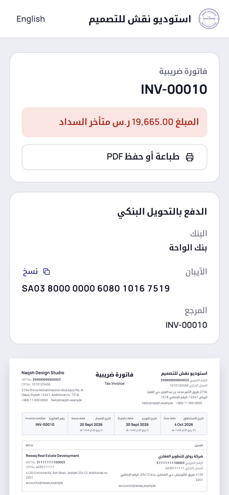

# Khatm (ختم)

Bilingual invoicing for small businesses in Saudi Arabia. Write a tax invoice, a simplified invoice or a quotation once, and Khatm lays it out in Arabic and English on one A4 page, with the QR code that ZATCA's first phase of e-invoicing requires. It numbers the document, works out the VAT to the halala, writes the total out in words in both languages, and gives you a private link to send. Payments, credit notes and the quarter's VAT figures follow from there.

*Khatm* is the Arabic word for a seal: the round company stamp Saudi businesses press onto their invoices. Every business in Khatm gets one, drawn from its own names and commercial registration number.



**Try it:** "Open the demo" on the home page gives you your own copy of Naqsh, a made-up design studio in Riyadh, with six months of invoicing behind it: paid, part-paid and overdue invoices, a credit note, a zero-rated export to Dubai, quotations and drafts. Record the last payment on an overdue invoice and the paid stamp comes down on the page. Open the customer's link in a private window to see what they see, or paste an invoice's QR text into the checker at `/verify`.

| | |
|---|---|
|  |  |
|  |  |

## What it does

**Documents**
- Tax invoices for businesses, simplified tax invoices for individuals, quotations, and credit notes.
- One A4 page in both languages, laid out the way Saudi bilingual invoices are printed: English from the left edge, Arabic from the right, whatever language the app is in. Gregorian dates with the Umm al-Qura date under them, the line table with discounts and VAT per line, a VAT breakdown per category, the total in words, bank details, notes and the business's seal.
- The editor draws the page as you type. Items come from your catalogue or are typed in, and quantities can be fractional (2.5 hours).
- Print it or save it as a PDF from the browser; the print stylesheet gives an exact A4 page.

**Issuing**
- Before issuing, Khatm lists what's still missing for that kind of document: your VAT number and national address, the buyer and their address on a tax invoice, a reason on a credit note.
- Issuing gives the document the next number in its sequence, freezes both parties as they are at that moment, stamps the time, and writes the QR code. After that it can't be edited.
- Mistakes are corrected the way the regulations expect: with a credit note that points back to the invoice. Credit notes can never add up to more than the invoice.
- An accepted quotation turns into a draft invoice with the same lines; the two link to each other.

**Getting paid**
- Payments (in full or in parts, by transfer, cash or card) and credit notes are set against each invoice, which is unpaid, part-paid, overdue, paid or credited accordingly.
- Each issued document has a private link. The customer sees it in their language, with the IBAN to pay into, and you see when they first opened it. Send it by WhatsApp or email from the document's page.
- The overview says what you're owed as a sentence, breaks it down by how late it is, and shows what came in this month, the VAT on this quarter's sales with the date the return is due, and six months of sales.

**VAT**
- The sales side of the quarterly return: standard-rated sales, zero-rated domestic sales, exports (zero-rated sales to buyers outside Saudi Arabia), exempt and out-of-scope sales, each net of credit notes, with the VAT due. Download it as CSV.
- A QR checker that reads any ZATCA QR payload, pasted or scanned with the camera (where the browser supports it), and checks the VAT number's format, the time stamp and the amounts.

**Everything else**
- Customers with their national address (building number, street, district, city, postal code, additional number), VAT and CR numbers, and an account page with what they've been billed and still owe.
- A catalogue of products and services with bilingual names, units, prices and VAT categories.
- Settings for the business's details, bank account, numbering (prefixes, and a starting number for businesses coming from another system), payment terms, default notes, and whether documents carry the seal.

## What it isn't

Khatm covers ZATCA's first phase (generation): compliant tax invoices with the phase-one QR code. It does **not** do the second phase (integration): no UBL 2.1 XML, no cryptographic stamp, no clearance or reporting through ZATCA's FATOORA platform. It hasn't been certified by ZATCA. It knows sales, not purchases, so it can't work out input VAT. It works in Saudi riyals only and has one user per business. It's a portfolio project, built to show the work rather than to replace accounting software.

## How it's built

| | |
|---|---|
| App | Next.js 16 (App Router, Cache Components, Server Actions), React 19, TypeScript |
| Data | Postgres with Drizzle ORM in its own `khatm` schema; PGlite (Postgres in WASM) locally and in tests |
| UI | Tailwind CSS 4, Manrope for Latin and Noto Kufi Arabic. No component, chart or animation library |
| QR codes | `qrcode` for the matrix, drawn as SVG |
| Hosting | Vercel and Neon, both on free plans |

### Decisions worth reading

**Money is integers.** Amounts are halalas and quantities are thousandths (1.5 hours is 1500), so nothing touches floating-point cents. VAT on a document is worked out per category on the summed taxable amounts and rounded once, the way ZATCA rounds; each line's own VAT is shown for reference and can differ from the document's by a halala. The browser shows live totals, but the server works them out again from the lines on every save.

**The QR code is five TLV fields.** Seller name, VAT number, time stamp, total with VAT and VAT, each written as a one-byte tag, a one-byte length and the UTF-8 value, then Base64. The encoder is tested against ZATCA's published example and against Arabic seller names, where the length is in bytes, not characters:

```ts
TAGS.forEach((key, i) => {
  const value = new TextEncoder().encode(fields[key]);
  parts.push(i + 1, value.length, ...value);
});
return toBase64(Uint8Array.from(parts));
```

**Numbers come from the issuing transaction.** The document is locked, checked, and numbered by the same `UPDATE … RETURNING` that moves the business's sequence on, so two invoices issued at the same moment can't share a number, and a unique index on (business, number) backs that up. Drafts don't take numbers and issued documents can't be deleted, so the sequence has no gaps. Tax and simplified invoices share one sequence; credit notes and quotations have their own.

**Issued means frozen.** Issuing copies the seller and the buyer into the document. Renaming a customer or moving the business later changes new documents, not the ones already sent.

**Amounts in words follow Arabic counting.** The noun changes with the number: ريال واحد، ريالان، ثلاثة ريالات، أحد عشر ريالًا، مئة ريال. Numbers from three to ten take the opposite gender to the noun (ثلاثة ريالات but ثلاث هللات), and a number followed by another noun goes into the construct state (ألفا ريال). The English line is written alongside. Both are tested on the awkward cases: 2,000, 11, 101,000, amounts with halalas only, and billions.

**Dates are days, in the business's time zone.** An invoice issued at 1 a.m. in Riyadh is dated that day, whatever UTC says. The Hijri date comes from the Umm al-Qura calendar in `Intl`; nothing is hand-converted.

**One page, drawn everywhere.** The A4 document is a pure component, so the editor draws a draft live in the browser and the server draws issued documents for the app, the share link and printing from the same code. It's laid out at A4 size and zoomed to its column; CSS container queries pick the zoom before any script runs, so a phone never sees the page cropped while it loads.

**The seal is generated.** Two rings, the Arabic name set along the top arc and the English along the bottom with SVG `textPath`, the CR number in the middle, and an SVG turbulence filter that speckles the ink like a rubber stamp. The paid stamp uses the same ink, and comes down on a spring when a payment settles an invoice.

**Share links are private by construction.** Each link is a 22-character random token, served with `Referrer-Policy: no-referrer` and `X-Robots-Tag: noindex`. Opening it records the first view, except when the business itself is the one looking.

**Accounts.** Passwords are hashed with scrypt and sessions are HMAC-signed cookies. The signing key is `AUTH_SECRET` when it's set; otherwise Khatm makes a random key the first time it needs one and keeps it in the database, so a fresh deployment needs no secrets and never signs with anything guessable. Sign-in is rate-limited per visitor and per email, sign-up and the demo per visitor, and every query and action is scoped to the signed-in business.

**A demo for every visitor.** "Open the demo" builds Naqsh for you in one transaction, issuing six months of backdated documents through the same code paths as the app (so numbers, QR codes and totals are real), and the account is deleted with everything in it after a day.

## Running it locally

```bash
npm install
npm run dev
```

Open http://localhost:3000 and open the demo or create an account. With no `DATABASE_URL`, Khatm creates an embedded Postgres in `.data/`. Settings are listed in [`.env.example`](.env.example).

## Tests

```bash
npm test
```

Unit tests cover the QR encoding (against ZATCA's example), VAT and IBAN checks, and amounts in words. The flow tests run the whole service on an in-memory Postgres: the demo's history and dashboard, what blocks issuing, numbering and frozen parties, the QR payload of an issued invoice, server-side totals, payments to the halala, overdue dates, credit-note limits, quotations becoming invoices, share links, isolation between businesses, sign-in, and cleanup.

## Project layout

```
src/server/        docs.ts (drafts, issuing, payments, credit notes), queries.ts (lists, overview, VAT return), demo.ts, accounts.ts, auth.ts
src/lib/           zatca (QR, VAT/CR/IBAN checks), tafqeet (amounts in words), amounts, dates (Hijri, quarters), i18n
src/components/    doc/ (the A4 document), editor/, seal.tsx, stamp.tsx, charts/, app/ (shell, lists), forms/
src/app/[lang]/    app/ (overview, documents, customers, products, vat, settings), i/[token] (share links), verify
src/db/            migrations (SQL), schema (Drizzle)
test/              unit and flow tests
```

Built by [Seif Ashraf](https://seifashraf.dev).
